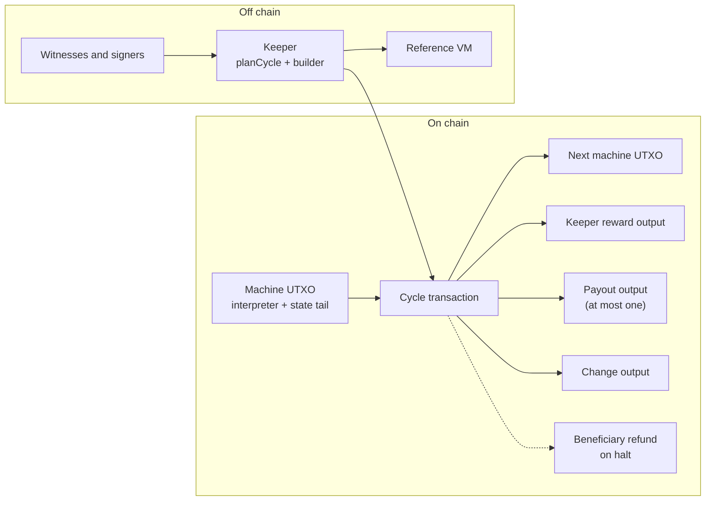
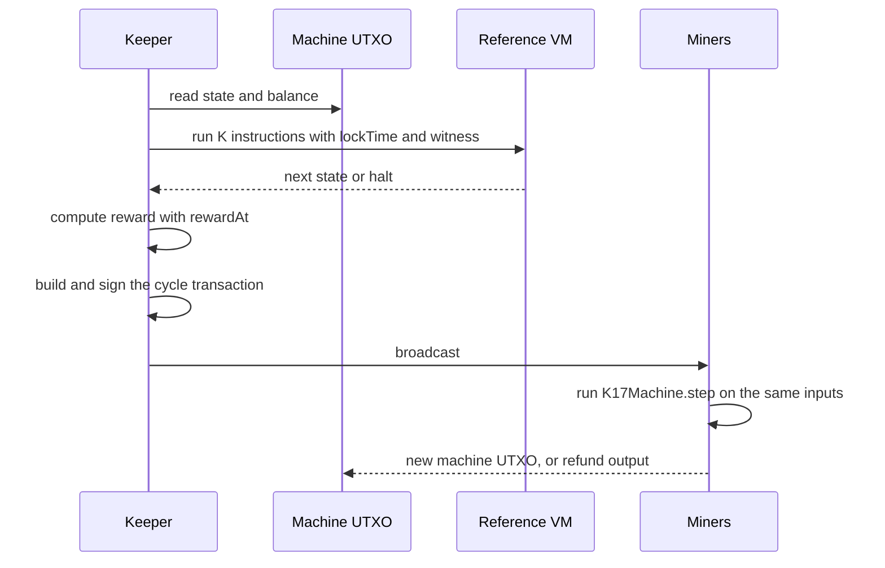
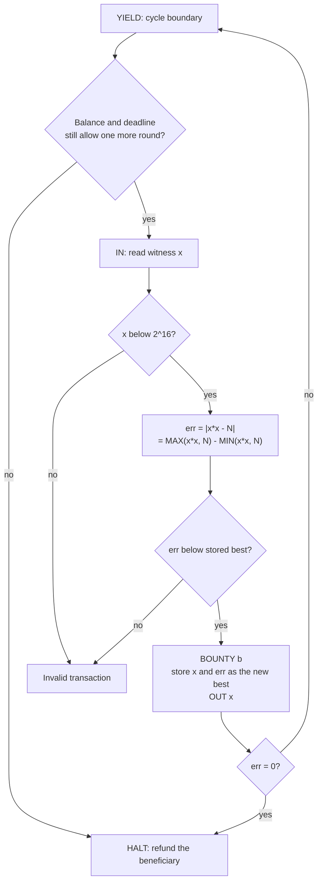
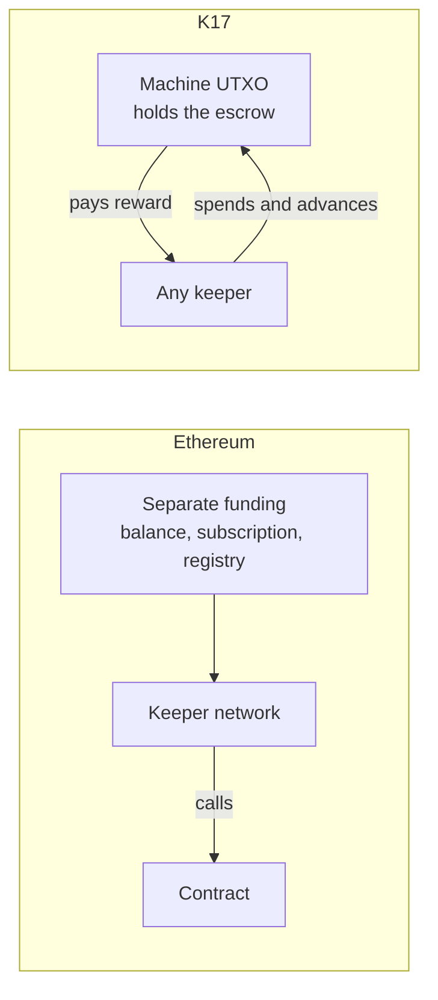
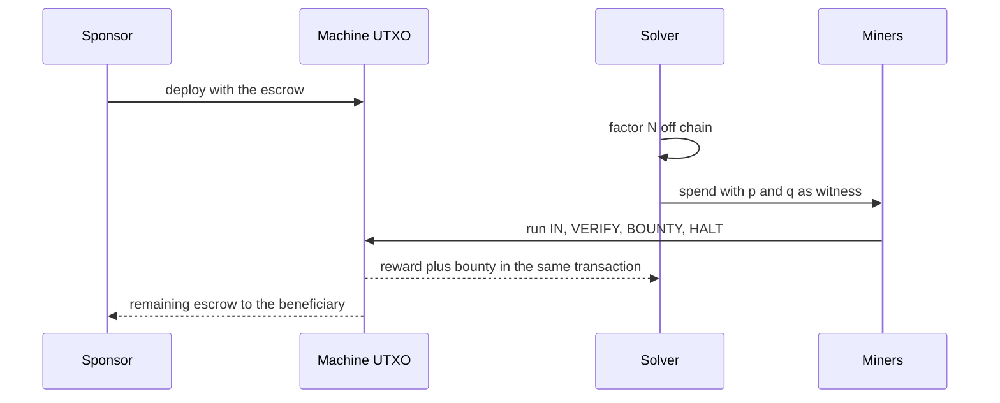

# K17 architecture

This document explains how K17 is built and why. It is for a developer who is new to the project. For the full rules, read [`README.md`](../README.md). For the published description, read the [defensive publication](K17-DEFENSIVE-PUBLICATION.md).

## 1. What K17 is

One UTXO holds one suspended stack-machine process. The locking script of that UTXO contains an interpreter. The end of the script holds the state of the process.

A spend runs up to K = 40 instructions. The spend is valid only if its first output recreates the UTXO with the state advanced by exactly those instructions. Anyone may spend the UTXO.

The contract pays the spender exactly the reward that it computes. It computes the reward from the time since the last cycle. It adds any `BOUNTY`. The total is capped at the balance less 1 sat. It shrinks to make room for a payout.

Miners check every cycle. So no off-chain party needs to be trusted for the result. A program that reads signed inputs still trusts the signer for those values.

## 2. System components



The machine UTXO holds the interpreter and the state. The immutable part fixes these items: the program, the beneficiary, the economics, `deadMan`, the SIGVERIFY roster, `instanceId` and `sponsorKeyHash`.

The state tail holds these items: `pc`, the data and return stacks, the memory and the output log. It also holds `lastTime`, the roster root and sequence number, and `logHash`. The interpreter code is the same in every cycle. Only the state tail changes.

- **Machine UTXO and sCrypt contract.** `src/contracts/k17Machine.ts` defines `K17Machine`. Its `step` method runs the K instructions, computes the keeper reward and builds the expected outputs. It then checks them against the transaction with the signature preimage.
- **Cycle transaction.** Its inputs are the machine UTXO (always input 0) and one or more fee inputs from the keeper. Its outputs are the next machine state, the keeper reward, any payout to a roster member and change. `bindCycleBuilder` in `src/keeper.ts` builds it.
- **Keeper.** The keeper is an off-chain program. `planCycle` in `src/keeper.ts` runs the reference VM. It also predicts the reward. `newMachine` in the same file creates a machine for deployment.
- **Reference VM.** `src/k17/vm.ts` is an executable specification of the ISA in `src/k17/isa.ts`. The keeper uses it to compute the next state. The contract must give the same result.
- **Witnesses and signers.** A program reads witness cells from the unlocking script with `IN`. Sensor nodes or sponsors make the signed readings (Rabin signatures). `src/k17/attest.ts` has the signing helpers. The party that relays a witness need not be the party that made it.
- **Beneficiary refund.** When the machine halts or faults, the first output is not a new machine. It pays the remaining balance to the `beneficiary` address. The address is fixed at deployment.

## 3. A cycle, step by step



The keeper chooses `nLockTime`, its own address and the witness cells. The reference VM runs the program with those values. The keeper then builds the transaction.

Miners run the contract. The contract repeats the same computation in Bitcoin script. If the two results differ, the transaction is not valid. `tests/k17Machine.test.ts` checks this on every cycle with the bundled script interpreter.

A cycle can fail in two ways. Keep them separate.

- **Fault.** The program causes it. Examples: a stack underflow, a bad memory address, a full output log, a second signature instruction in one cycle. A fault acts like `HALT`. The machine stops and the balance goes to the beneficiary. The keeper still gets its reward. A fault never makes the transaction invalid, so a fault can never freeze the escrow.
- **Invalid transaction.** The witness causes it. Examples: `IN` with no witness cell left, `VERIFY` of zero, a missing or wrong signature, key or Merkle proof. Miners reject the transaction, and the UTXO stays as it was. Another keeper can try again with a correct witness.

A program that waits for a witness nobody has would never fault. For that case, use a non-zero `deadMan` interval. The machine then halts before its first instruction when `nLockTime >= lastTime + deadMan`. The beneficiary gets a refund and no witness is needed. See "Freeze escape" in the README.

## 4. Long-running machines

A K17 machine is not a one-spend contract. It is one UTXO that the keepers spend many times. Each cycle recreates the output with the advanced state. A program can loop as long as the escrow and the program allow.

Three programs in this repository show the pattern. `heartbeatProgram` loops with no end. The output log limit stops it (section 7). `fibonacciProgram(n)` and `countdownProgram(n)` in `src/k17/programs.ts` loop `n` times and then `HALT`. The companion repository, [`k17-dc4cd`](https://github.com/Bittoku/k17-dc4cd), has multi-round consortium programs. They run one round after another. Its README ("Operational rules") describes the per-round rules.

Three limits end a long-running machine.

1. **The escrow.** Each cycle pays the keeper reward and any bounty, so the balance falls. A program can read the balance with `VALUE` and stop when it is too low. A `PAYSLOT` or `PAYLEAF` payout that the balance cannot cover (balance less 1 sat) is a fault. The machine then halts and refunds the beneficiary. A `BOUNTY` that is too large is not a fault. The contract caps the reward plus bounty at the balance less 1 sat. A program that must pay in full needs to check `VALUE` first. Anyone can add funds to a machine that is alive (section 5).
2. **The program deadline.** The program reads `TIME` and halts after its own limit.
3. **The dead-man interval.** A non-zero `deadMan` ends a machine that nobody advances (section 3).

### 4.1 Iterative improvement with a bounty

A program can run a search that never needs to finish. It keeps the best result so far in memory. A solver supplies a witness. The program accepts the witness only if a quality that the program computes and miners check beats the stored best. For each accepted witness the program does these things:

- It pays a bounty with `BOUNTY`.
- It stores the new best.
- It loops to wait for the next witness.

Each accepted answer is strictly better than the one before it. A witness that is not better makes the transaction invalid (`VERIFY` of zero). The UTXO stays as it was.

Two constraints apply.

- The program must compute the quality inside one cycle of K = 40 instructions. The ISA has 32-bit unsigned cells. It has no signed or floating arithmetic.
- A cycle can pay only its spender. Every `BOUNTY` in the cycle adds to the keeper reward, which is one output. The reward is capped at the balance less 1 sat.

**Sketch — not a program in this repository.** The quality is a closer integer approximation of the square root of `N`. The witness `x` is accepted when `|x*x - N|` is smaller than the stored best error. `best` starts at `N`, the error of `x = 0`.



1. At the cycle boundary, read `VALUE` and `TIME`. Halt if the balance is too low or the deadline has passed.
2. Read the witness `x` with `IN`. Check that `x` has no bit set in `0xffff0000`. This stops `x*x` from wrapping in 32 bits.
3. Compute `err` as `MAX(x*x, N) - MIN(x*x, N)`. This avoids a negative result.
4. Check `err < best`. There is no less-than instruction. For `best >= 1`, the test `MIN(err, best - 1) == err` has the same meaning.
5. Run `VERIFY` on that test. A worse witness makes the transaction invalid.
6. Run `BOUNTY b`, store `x` and `err` in memory, and log `x` with `OUT`.
7. If `err` is zero, `HALT` and refund the beneficiary. Otherwise `YIELD` and loop.

The step list is a plan. Nobody has written, sized or run this program. The count of instructions per stage is not measured. Three open points remain. A bystander can copy a pending witness and front-run it, as in section 8. A fixed bounty pays for a tiny improvement as much as for a large one, so a solver who knows a good answer can send a chain of small improvements and collect a bounty for each. Also, each cycle costs at least `rewardMin + 60 * slope`, so many small improvements use the escrow quickly.

## 5. Topping up the escrow

**Top-up is supported from this version.** Anyone can add satoshis to a running machine. No signature from the machine's parties is necessary, so a machine can be crowd-funded.

A top-up is part of a normal cycle. `step` has an 11th argument, `topUp`. Extra inputs of the same transaction supply the satoshis. The next machine output then holds `value - reward - payout + topUp` satoshis, where the contract computes `value - reward - payout` as before. The contract checks the whole output set by hash (`hash256(outputs) == hashOutputs`), so the top-up can go only into the machine output.

Rules:

- **Anyone can top up.** The contract does not check who supplies the extra inputs.
- **`topUp` is 0 or more.** A negative value would move machine satoshis into the change output. The transaction is then not valid.
- **A halting cycle takes no top-up.** Some cycles do not keep the machine alive: `HALT`, a fault, the dead-man, and a payout that the balance cannot cover. Such a cycle must have `topUp = 0`. Otherwise the transaction is not valid. Thus a top-up never goes to the beneficiary through a refund. The keeper helper `planCycle` refuses such a plan before it builds a transaction.
- **A top-up does not change `lastTime`.** It also does not change the keeper reward, the payout, `MIN_STEP` or the dead-man rule. They all use the input value and the clock. The cycle moves `lastTime` to `nLockTime` as every live cycle does. Thus money alone cannot keep a machine alive. A machine that waits for a witness still halts at `lastTime + deadMan`, and the refund then includes the earlier top-ups.
- **`VALUE` shows the top-up from the next cycle.** The cycle that carries the top-up reads the old balance.
- **`topUp = 0` is the canonical value** when the cycle adds nothing. On a live cycle the value of the machine output pins `topUp`, so a relayer cannot change it.

Who supplies the extra inputs:

- **The keeper (self-funded).** The keeper's wallet adds its own coins for the top-up and the fee. The change goes back to the keeper.
- **A separate funder.** The keeper adds the funder's coins as inputs. Their sum must be exactly `topUp`. The funder waits until the transaction is final. The funder computes `remaining` itself: it replays `planCycle` on the real machine UTXO. It checks that output 0 equals `remaining` plus the sum of its own coins. It also checks that the `topUp` argument of the machine input equals that sum. Without these checks, a dishonest builder can move the excess of the funder's coin over `topUp` into the keeper's change. The funder coins must be P2PKH, because the fee estimate does not count other unlocking-script sizes. Then it signs its own inputs with `SIGHASH_ALL`. The signature covers all outputs, so nobody can move the funder's coins to another output after it signs. The keeper can refuse to include a funder's coins. That delays the top-up, but the funder keeps its coins.

A blocked machine cannot get a top-up: no cycle runs until a witness arrives. A transaction that only sends coins to the same locking script creates a second, independent UTXO with the same state. The contract never merges the two.

### 5.1 Compatibility

- The top-up changes the locking script. It is a new contract template and a new artifact (`artifacts/k17Machine.json`). The script is 26 bytes larger (183 012 bytes at K = 40).
- Machines deployed before this version cannot be topped up. Their code is fixed in their UTXO. They keep the earlier rule: the next machine output holds exactly `value - reward - payout`. For such a machine, deploy with enough escrow for its intended life. Or let it halt and deploy a new machine. A new deployment can carry over memory (the initial memory image) and a roster root. It cannot carry over the stacks, the output log or `logHash`.
- Every caller of `step` must pass 11 arguments. A call with the earlier 10 arguments fails.
- The published disclosures, including the [defensive publication](K17-DEFENSIVE-PUBLICATION.md), describe the earlier behaviour: one `step` method and exact value conservation. They do not describe the top-up.

## 6. K17 compared with Ethereum keeper contracts

An Ethereum contract cannot run itself. A transaction must call it. Scheduled work (a liquidation, an oracle update, a rebalance) therefore relies on keepers. Networks such as Chainlink Automation, Gelato and Keep3r supply them.

In the usual setup the job owner prepays the network through a balance, subscription or registry. The contract accepts any caller. Or it checks `msg.sender` against the forwarder of the network or a keeper list. Some protocols pay callers from the contract itself (liquidation bonuses, for example). K17 makes that pattern the only one and builds it into the interpreter.

In K17 the contract pays for its own heartbeat out of its own escrow. The reward grows with the time since the last cycle. The spender who advances the machine takes it. There is no registry and no privileged keeper. K17 still needs some off-chain party to run a keeper. It removes the separate funding and the registry, not the keeper.



| Question                         | Ethereum keeper contracts                                                                                      | K17                                                                                         |
| -------------------------------- | -------------------------------------------------------------------------------------------------------------- | ------------------------------------------------------------------------------------------- |
| Who pays the keeper?             | Usually a separate balance, subscription or registry outside the contract.                                     | The contract, from its own escrow.                                                          |
| Who may advance the contract?    | Any caller. Or only the forwarder of the network or listed keepers (`msg.sender` check). The contract chooses. | Anyone who builds a valid spend.                                                            |
| How is the price set?            | By the fee rules of the network or the budget of the owner.                                                    | By competition. The reward is a Dutch auction on elapsed time.                              |
| What if no keeper wants the job? | The job may wait until funding or fees change.                                                                 | The reward keeps growing, up to `rewardMax`, until someone takes it.                        |
| What ends the contract?          | The owner cancels or stops funding the job.                                                                    | `HALT`, a fault, or the dead-man halt refunds the beneficiary.                              |
| Conditions the work can check    | Rich: any contract state, price feeds, any logic.                                                              | Limited: a 43-instruction machine, 32-cell stacks, 256 memory cells (152 for program data). |
| Cost of one execution            | Gas for the computation, small per call compared with K17.                                                     | High. Every cycle carries the full interpreter.                                             |

**How the auction works.** The contract computes `elapsed = nLockTime - lastTime`. It allows the reward `min(rewardMin + slope * elapsed, rewardMax)`. Miners enforce `nLockTime` as a bound on the time of the block. A keeper cannot claim a long wait without a real wait.

A cheap keeper moves early and takes a small reward. A costly keeper wins only when the cheap ones are gone.

A live cycle must also advance the clock by at least `MIN_STEP` = 60 seconds. Without this rule, a keeper could hold `nLockTime` at `lastTime` while it drives the machine. Then `lastTime` would lag the chain clock. The dead-man halt would come early.

**What Ethereum keepers do well.** They can check complex conditions, and they run for little gas. K17 pays for its generality in size. The README measures the K = 40, 43-handler locking script at 182 986 bytes. It measures the final (halting) cycle transaction at 183 626 bytes.

A cycle that keeps the machine alive also carries the next state output. It is about twice the size of the locking script. The one measured live cycle is the enrolment cycle of `enrolAndAttestProgram`, at 366 514 bytes.

The clock rule also limits speed. At `nLockTime` = MTP - 1, a keeper gets about one live cycle per block. K17 suits slow, valuable, trust-minimised work. It does not suit work that needs fast, cheap and frequent calls.

## 7. Paying for the heartbeat of a contract

`heartbeatProgram` in `src/k17/programs.ts` is the smallest program that proves a machine is alive. It logs the time of each cycle that it runs in.

```
loop:  TIME  OUT  LIT 0  IF loop
```

`TIME` pushes the `nLockTime` of the transaction. `OUT` appends it to the output log. `LIT 0` then `IF loop` is an unconditional jump. `IF` branches when the top of the stack is zero.

The loop has four instructions, so one cycle of K = 40 runs ten loops. The output log holds at most 256 cells (`OUT_MAX`). When it is full, the machine faults and refunds the beneficiary.

The economics are fixed at deployment in `Economics` (`src/keeper.ts`):

| Parameter   | Meaning                                                                                                              | Example             |
| ----------- | -------------------------------------------------------------------------------------------------------------------- | ------------------- |
| deposit     | Satoshis in the machine UTXO                                                                                         | 100 000             |
| `rewardMin` | Reward at zero elapsed time. `newMachine` refuses a value below 1.                                                   | 10                  |
| `slope`     | Satoshis added per second of elapsed time                                                                            | 2                   |
| `rewardMax` | Cap on the auction reward                                                                                            | 1 000               |
| `deadMan`   | Dead-man interval in seconds. 0 turns it off. At least 6 hours (`DEAD_MAN_FLOOR`) unless `allowShortDeadMan` is set. | 2 592 000 (30 days) |

The example values are for illustration only. The reward is `min(rewardMin + slope * elapsed, rewardMax)`. Because of `MIN_STEP`, the smallest reward of a live cycle is `rewardMin + 60 * slope`. The contract also never lets the reward take the last satoshi of the machine.

| Elapsed since last cycle | Reward                                    |
| ------------------------ | ----------------------------------------- |
| 60 s                     | 130 sats                                  |
| 120 s                    | 250 sats                                  |
| 300 s                    | 610 sats                                  |
| 600 s                    | 1 000 sats (cap: the formula gives 1 210) |
| 3 600 s                  | 1 000 sats                                |

`rewardMin` must be at least 1 sat, so that every cycle pays a keeper output. That output fixes the `keeper` argument in the transaction, so a relayer cannot rewrite it.

One exception remains. A PAYSLOT or PAYLEAF payout, or a 1-sat balance, can clamp the reward to 0. Then there is no keeper output, and `keeper` is not pinned (see "Residual malleability" in the README).

Choose `deadMan` as a multiple of the round length. It counts on the median-time-past clock of the chain, not on wall time. A jump of `deadMan` or more in that clock lets any keeper end a healthy machine.

## 8. Job bounties: a simple example

A bounty is a payment for a checked answer. `factoringBountyProgram(n, bounty)` pays `bounty` satoshis to the party that supplies the two 16-bit factors of the 32-bit number `n`. This is the program, as it stands in `src/k17/programs.ts`:

```
YIELD                                              // stage boundary
IN IN                                              // p q
OVER LIT 0xffff0000 AND 0= VERIFY                  // p < 2^16
DUP  LIT 0xffff0000 AND 0= VERIFY                  // q < 2^16
OVER LIT 1 - VERIFY                                // p != 1
DUP  LIT 1 - VERIFY                                // q != 1
OVER OVER * LIT n - 0= VERIFY                      // p*q == N
BOUNTY bounty
OUT OUT
HALT
```

`IN IN` reads the two witness cells. The `VERIFY` lines check the range of each factor, rule out the factor 1, and check that the product equals `n`. A failed `VERIFY` makes the transaction invalid, so the network refuses a wrong answer. `BOUNTY` authorises `bounty` extra satoshis for the spender. `OUT OUT` logs `q` and `p`. `HALT` returns the rest of the escrow to the beneficiary.



The program starts with `YIELD`. Any keeper can run the first cycle, which ends there. The cycle of the solver then starts at the next instruction. It runs the whole stage (31 instructions, below K = 40) in one transaction.

`YIELD` makes the stage atomic. It ends a cycle early, so the checks and the payment cannot be split across two transactions. The party that supplies the witnesses is the party that gets paid.

Front-running is the weakness of any bounty. A bystander can read the solution from a pending transaction. The bystander can then send the same answer with their own address. `twoStageJobProgram` closes this gap for its second stage with a commit-reveal step bound to the payee. Its first stage, like the plain factoring bounty, can still be front-run.

Stage 1 is the factoring bounty above. It stores `p` in memory. Stage 2 asks for `x` such that `HASH(x XOR p) == target`.

1. A solver commits `c = HASH(x XOR WHO)`. `WHO` pushes the first four bytes of the address of the spender, so the commitment names the payee.
2. In the reveal, the machine checks `HASH(x XOR WHO) == c` with the current spender. Only the address of the committer passes.

A commit can be overwritten after `commitTtl` seconds. This stops a bogus commit from blocking the job. A `deadline` is checked at the start of every stage-2 cycle. If stage 2 is not finished in time, this check halts the machine and refunds the escrow.

Stage 1 has no deadline. Deploy with a non-zero `deadMan`, so that an unsolved stage 1 can still be refunded. The header comment of the function in `src/k17/programs.ts` gives the sizing rules for the TTL.

## 9. Where to go next

- [`README.md`](../README.md): the layout, the commands, the rules for each cycle, the freeze escape and the measurements.
- [`CLAUDE.md`](../CLAUDE.md): working rules for contributors, including why the contract keeps its loop variables small.
- [`K17-DEFENSIVE-PUBLICATION.md`](K17-DEFENSIVE-PUBLICATION.md): the published description of the design (sections 4 and 5) and the acknowledged prior art (section 3). It is a frozen record. The code is newer, so where they differ, the code is correct. The disclosure is also at <https://www.tdcommons.org/dpubs_series/12327/>.
- `src/k17/isa.ts`: the opcode table and the encoding.
- `src/k17/programs.ts`: all example programs.
- [`k17-dc4cd`](https://github.com/Bittoku/k17-dc4cd): the companion repository, with Forth tooling, sensor consortiums and Merkle rosters.
